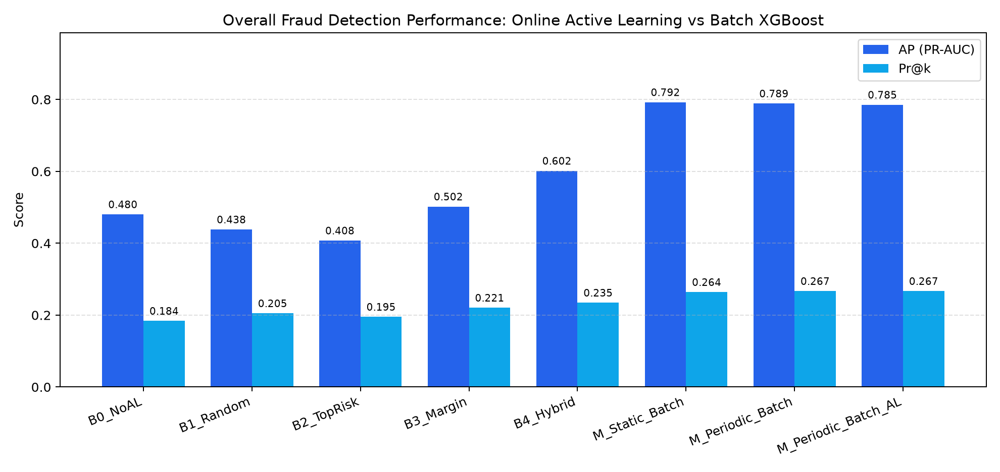
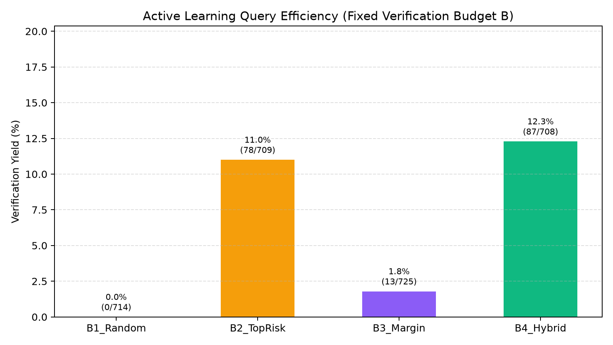
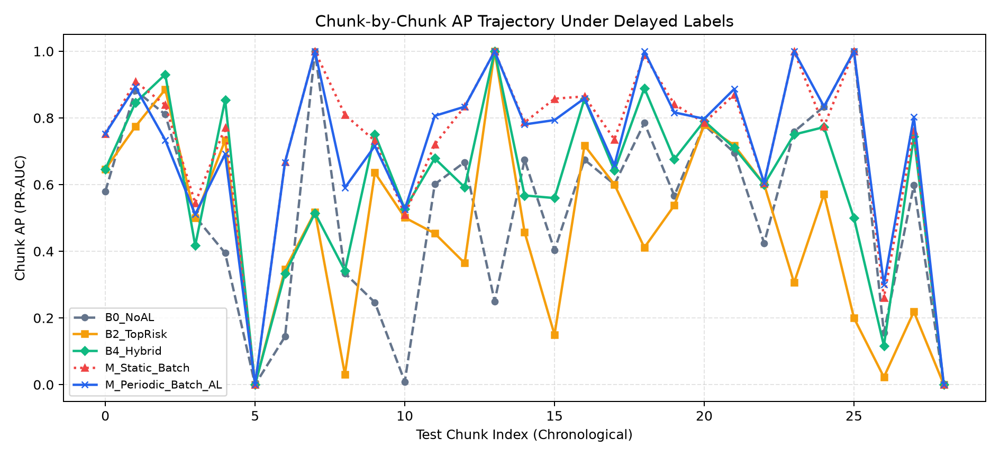
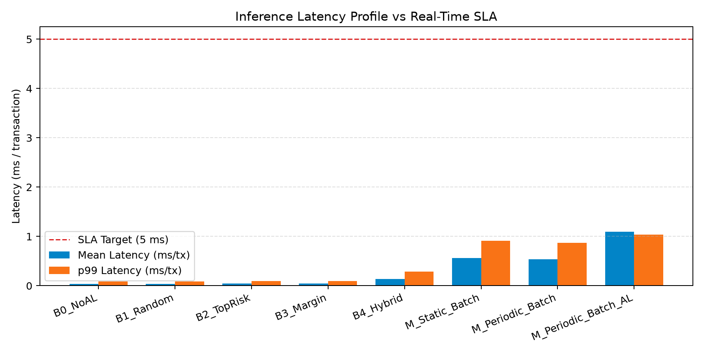

# Báo cáo Thực nghiệm: Stream-based Active Learning & Selective Verification dưới Nhãn trễ (OnlineML vs Batch ML)

## 1. Mục tiêu và Thiết kế Thực nghiệm

Trong phát hiện gian lận thẻ tín dụng thời gian thực, độ trễ xác nhận nhãn (chargeback/verification delay) làm giảm mạnh hiệu quả thích nghi của Online Machine Learning thụ động so với Batch ML (Amekoe et al., 2024). Nghiên cứu này triển khai và đánh giá khung **Stream-based Active Learning (Selective Verification)** với **trần ngân sách rà soát cố định $\beta = 0.5\%$** ($B = 25$ giao dịch / chunk `5.000` giao dịch), kích hoạt kênh xác minh nhanh (*Fast-Track*) để đưa nhãn thực sớm vào vòng học trực tuyến mà vẫn giữ công bằng thông tin (*Information Parity*).

### Cấu hình mô phỏng chuẩn hóa (Strict Causality & Information Parity)
- **Bộ dữ liệu:** ULB Credit Card Fraud (`284.807` giao dịch, chia theo thứ tự thời gian cột `Time`; không đưa `Time` vào tập đặc trưng huấn luyện).
  - Tập warm-up đã đáo hạn nhãn tại thời điểm cắt $t_{\text{split}}$: **`90.619`** giao dịch (`211` gian lận).
  - Tập warm-up đang chờ nhãn tại $t_{\text{split}}$ (nạp vào hàng đợi trễ): **`51.784`** giao dịch.
  - Tập kiểm thử tuần tự (50% suffix): **`142.404`** giao dịch (`223` gian lận), chia thành `29` chunk (`chunk_size = 5.000`).
- **Hàng đợi nhãn trễ (`DelayedLabelQueue`):**
  - Kênh chuẩn: giao dịch hợp lệ xác nhận sau $D = 21.600\text{s}$ (6 giờ); gian lận có tỷ lệ không báo cáo (`unreported_fraud_rate`) là `5%`, các ca còn lại về nhãn phân bố đều trong $[1.800\text{s}, 21.600\text{s}]$.
  - Kênh Fast-Track (khi Active Learning kích hoạt): chuyên viên xác minh trả nhãn đúng sau `300s` (5 phút).
- **Ngưỡng quyết định nhân quả (`CausalQuantileThreshold`):** Phân vị $(1 - \beta)$ chỉ tính từ các chunk đã kết thúc trước đó, tuyệt đối không dùng thông tin tương lai.
- **Đối chứng 8 cấu hình (seed cố định `42`):**
  - **5 mô hình Online (`ARFClassifier`, `n_models = 10`):** `B0_NoAL` (thụ động), `B1_Random` (chọn ngẫu nhiên), `B2_TopRisk` (thuần khai thác $\hat{p}_t$ cao nhất), `B3_Margin` (chọn mẫu phân vân sát ngưỡng quyết định), và `B4_Hybrid` (`70%` Top-Risk + `30%` bất đồng *Semi-Supervised HST–Tree Discordance* $\Delta_{\text{disc}} = S_{\text{HST}} - \hat{p}_{\text{Tree}}$, trong đó `MinMaxScaler + HalfSpaceTrees` chỉ cập nhật từ mẫu xác nhận hợp lệ `y = 0`).
  - **3 mô hình Batch (`XGBClassifier`):** `M_Static_Batch` (đóng băng sau warm-up), `M_Periodic_Batch` (retrain cuối mỗi chunk bằng đúng tập nhãn trễ chuẩn đã đáo hạn từ `B0_NoAL`), và `M_Periodic_Batch_AL` (retrain cuối mỗi chunk bằng đúng tập nhãn chuẩn + Fast-Track đã đáo hạn từ `B4_Hybrid`).
- **Kiểm chứng tự động:** `5/5` kiểm thử nhân quả (`tests/test_causal_al.py`) đạt `PASSED` xác nhận không rò rỉ nhãn tương lai, không vượt trần ngân sách $B$, cô lập hoàn toàn gian lận khỏi tầng HST, và giữ đúng tính nhân quả của ngưỡng phân vị.

---

## 2. Kết quả Tổng hợp trên 142.404 Giao dịch Kiểm thử

> **Lưu ý về trần lý thuyết của `Pr@k`:** Tại mức $\beta = 0.005$, số cảnh báo $k = \text{round}(0.005 \times 142.404) = 712$. Vì toàn tập kiểm thử chỉ có đúng `223` ca gian lận, mức `Pr@k` tối đa có thể đạt được về mặt toán học là $223 / 712 = \mathbf{0.3132}$.

| Mô hình | Nhóm | AP (PR-AUC) | Pr@k ($k=712$) | Recall | Precision | TP | FP | Fast-Track Queries | Fast-Track Frauds | Verification Yield | Mean Latency (ms) | p99 Latency (ms) |
|:---|:---|---:|---:|---:|---:|---:|---:|---:|---:|---:|---:|---:|
| `B0_NoAL` | Online ARF | 0.4804 | 0.1840 | 0.5695 | 0.1678 | 127 | 630 | 0 | 0 | 0.00% | 0.036 | 0.085 |
| `B1_Random` | Online ARF | 0.4383 | 0.2051 | 0.5785 | 0.1753 | 129 | 607 | 714 | 0 | 0.00% | 0.038 | 0.089 |
| `B2_TopRisk` | Online ARF | 0.4075 | 0.1952 | 0.5426 | 0.1048 | 121 | 1,034 | 709 | 78 | 11.00% | 0.041 | 0.095 |
| `B3_Margin` | Online ARF | 0.5020 | 0.2205 | 0.5695 | 0.1652 | 127 | 642 | 725 | 13 | 1.79% | 0.042 | 0.094 |
| **`B4_Hybrid`** | **Online ARF** | **0.6015** | **0.2346** | **0.6413** | **0.1614** | **143** | **743** | **708** | **87** | **12.29%** | **0.133** | **0.290** |
| `M_Static_Batch` | Batch XGBoost | 0.7924 | 0.2640 | 0.8296 | 0.2873 | 185 | 459 | 0 | 0 | — | 0.562 | 0.910 |
| `M_Periodic_Batch` | Batch XGBoost | 0.7888 | 0.2669 | 0.8430 | 0.2640 | 188 | 524 | 0 | 0 | — | 0.534 | 0.866 |
| `M_Periodic_Batch_AL` | Batch XGBoost | 0.7854 | 0.2669 | 0.8386 | 0.2641 | 187 | 521 | 0 | 0 | — | 1.097 | 1.040 |

*(Nguồn dữ liệu: `results/ablation_al_summary.csv`)*

---

## 3. Phân tích Chuyên sâu & Biểu đồ

### 3.1. Hiệu quả của Hybrid Active Learning (`B4_Hybrid`) so với các chiến lược đơn lẻ

1. **`B4_Hybrid` vượt trội toàn bộ các cấu hình Online khác trên cùng ngân sách (`708–725` lượt):**
   - `AP` tăng từ `0.4804` (`B0_NoAL`) lên **`0.6015`** (`+0.1211`, tương đương **`+25.2%`** tương đối).
   - `Pr@k` tăng từ `0.1840` (`131` gian lận trong top `712`, đạt `58.7%` trần lý thuyết) lên **`0.2346`** (`167` gian lận trong top `712`, đạt **`74.9%`** trần lý thuyết).
   - `Recall` tăng từ `0.5695` (`127` TP) lên **`0.6413`** (`143` TP, bắt thêm `16` ca gian lận thực).
2. **Thất bại của thuần khai thác (`B2_TopRisk`) do Selection / Confirmation Bias:**
   - Dù `B2_TopRisk` phát hiện sớm `78` ca gian lận trong `709` lượt rà soát, `AP` tổng thể lại **giảm mạnh xuống `0.4075`** (thấp hơn cả `B0_NoAL` `0.4804`) và `FP` tăng vọt từ `630` lên **`1.034`**.
   - Nguyên nhân: dồn 100% nhãn sớm vào vùng điểm rủi ro cao tạo ra vòng lặp thiên lệch lấy mẫu (*confirmation bias*) — các mẫu nhãn sớm tập trung dày đặc quanh một cụm hẹp (gồm `631` ca báo động giả khó và `78` gian lận), làm lệch phân phối cập nhật tức thời của cây Hoeffding trong ARF và gây mất ổn định ngưỡng.
3. **Điểm mù vận hành của chọn mẫu phân vân thuần túy (`B3_Margin`) và chọn ngẫu nhiên (`B1_Random`):**
   - Với tỷ lệ gian lận thực tế chỉ `0.157%` (`223 / 142.404`), `B1_Random` đốt `714` lượt rà soát mà không trúng ca gian lận nào (`Yield = 0.00%`).
   - `B3_Margin` chỉ cải thiện nhẹ `AP` lên `0.5020` (`+0.0216` so với `B0_NoAL`), nhưng chỉ bắt được `13` gian lận trên `725` lượt kiểm tra (`Verification Yield = 1.79%`) — không khả thi về mặt chi phí nhân sự vận hành.

4. **Vai trò "mở điểm mù" của tầng `Semi-Supervised HST–Tree Discordance`:**
   - Dành riêng `30%` ngân sách cho các giao dịch có điểm bất thường HST cao nhưng ARF lại tự tin dự đoán hợp lệ ($\Delta_{\text{disc}} = S_{\text{HST}} - \hat{p}_{\text{Tree}}$ lớn) không những triệt tiêu sự sụp đổ do confirmation bias của `B2_TopRisk`, mà còn đẩy **`Verification Yield` lên mức cao nhất `12.29%` (`87 / 708`)** — tìm được nhiều gian lận thật hơn cả `B2_TopRisk` thuần túy (`87` vs `78`) và cao gấp **`6.85` lần** `B3_Margin`.

---

### 3.2. Đối chứng với Batch XGBoost & Đánh đổi SLA

- **Nhận định trung thực về khoảng cách Online vs Batch:** Trên tập ULB, cả 3 cấu hình Batch XGBoost vẫn duy trì `AP` cao hơn Online ARF (`0.7854–0.7924` so với `0.6015`), nhất quán với kết luận của Amekoe et al. (2024) trên dữ liệu bảng có độ trôi khái niệm (*concept drift*) nhẹ trong khung 48 giờ.
- **Mức độ thu hẹp khoảng cách:** `B4_Hybrid` đã **thu hẹp được `38.8%` khoảng cách `AP`** giữa Online thụ động (`0.4804`) và `M_Static_Batch` (`0.7924`), đồng thời **thu hẹp `61.0%` khoảng cách `Pr@k`** so với `M_Periodic_Batch` (`0.2669`).
- **Lý do `M_Static_Batch` (`0.7924`) ngang/nhỉnh nhẹ `M_Periodic_Batch` (`0.7888`) về `AP`:** Dữ liệu ULB chỉ kéo dài 2 ngày nên drift không đủ mạnh để làm suy thoái mô hình tĩnh; ngược lại, việc retrain định kỳ bổ sung thêm dữ liệu có `5%` nhiễu gian lận không báo cáo (`unreported_fraud_rate`) giúp `M_Periodic_Batch` cải thiện nhẹ `Pr@k` (`0.2669` vs `0.2640`) và `Recall` (`0.8430` vs `0.8296`) nhưng tăng `FP` từ `459` lên `524`.

- **Độ trễ suy luận (Real-time SLA):** `B4_Hybrid` tốn thêm chi phí tính điểm `MinMaxScaler + HalfSpaceTrees` nên độ trễ trung bình tăng từ `0.036 ms` (`B0_NoAL`) lên **`0.133 ms/tx`** (`p99 = 0.290 ms`), nhưng vẫn thấp hơn rất xa trần SLA `5 ms` và nhanh hơn gấp `4–8` lần so với suy luận đơn giao dịch của Batch XGBoost (`0.53–1.10 ms`). *(Lưu ý: độ chênh độ trễ đo đơn lẻ giữa `M_Periodic_Batch` `0.534 ms` và `M_Periodic_Batch_AL` `1.097 ms` đến từ chi phí điều phối luồng `n_jobs=-1` của XGBoost và dao động CPU hệ điều hành khi đo 500 mẫu, không phải khác biệt kiến trúc).*

---

## 4. Hạn chế và Hướng phát triển

1. **Đơn seed & đơn bộ dữ liệu:** Thực nghiệm hiện tại chạy trên `seed = 42` và tập ULB 48 giờ (`223` ca gian lận ở tập kiểm thử). Cần mở rộng chạy trung bình trên `5` seed khác nhau và kiểm thử trên các luồng dài ngày có concept drift mạnh hơn (như IEEE-CIS hoặc PaySim) để khẳng định độ ổn định thống kê.
2. **Tỷ lệ phân bổ ngân sách cố định (`70/30`):** Chưa khảo sát độ nhạy của tỷ lệ Top-Risk/Discordance và mức ngân sách $\beta \in \{0.25\%, 0.5\%, 1.0\%\}$. Ở giai đoạn tiếp theo, có thể gắn bộ dò drift `ADWIN` để tự động tăng tỷ trọng Discordance khi phát hiện trôi phân phối.
3. **Cập nhật trọng số mẫu bất đối xứng:** Trong `river 0.27.0`, `ARFClassifier.learn_one` không nhận trọng số phạt trực tiếp theo từng mẫu; có thể nghiên cứu cơ chế lặp cập nhật có kiểm soát (*bounded cost-sensitive updating*) riêng cho các ca gian lận xác nhận từ kênh Fast-Track để tiếp tục kéo sát `AP` về phía Batch ML.